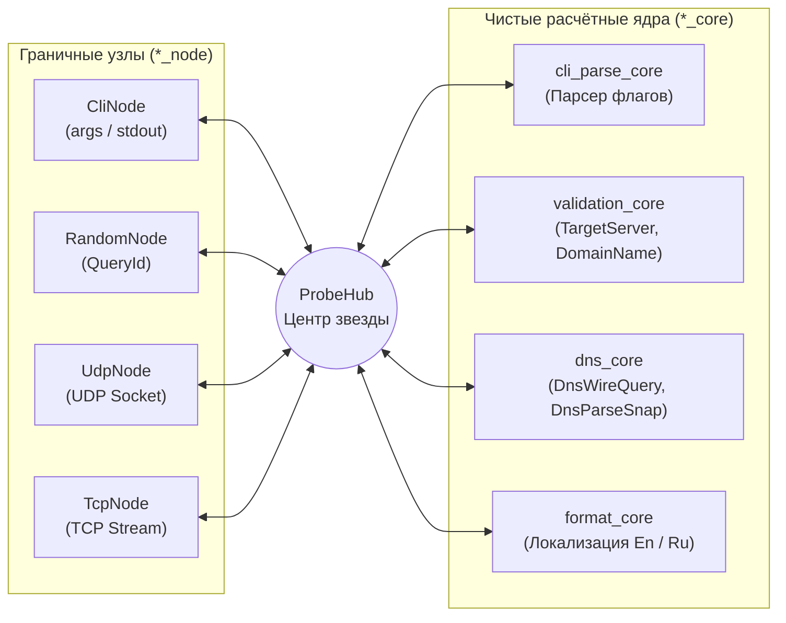

# dns-tester


-blue.svg)


Диагностическая CLI-утилита для глубокой проверки DNS-серверов и **эталонная реализация [Изолирующей фрактальной архитектуры (ИФА)](https://gist.github.com/Ghost-3/04b7e726be2a7f1795a7f5495bca4f1f)**.

> **Главный инвариант архитектуры:** *не держи в голове то, что можно вынести в форму.*  
> На уровне кода форма — это биографические типы и исчерпывающие состояния (`Snap`) вместо исключений и размытых `Result`. На уровне системы — топология звезды, в которой узлы не знают друг о друге, а когнитивная глубина в любом файле равна единице.

---

## Что умеет утилита

- **4 режима транспорта:**
  - `--auto` *(по умолчанию)* — запрос по UDP с автоматическим переключением на TCP при усечении пакета (`TC=1`).
  - `--udp` — принудительно только UDP.
  - `--tcp` — принудительно только TCP.
  - `--both` — последовательная проверка обоих протоколов побайтово идентичным пакетом запроса.
- **Рентген таймингов TCP (3 непересекающиеся фазы):** раздельный замер установки соединения (`connect`), ожидания первого байта ответа (`first_byte`) и дочитывания потока (`transfer`).
- **Нулевая потеря данных (Data Salvaging):**
  - При обрыве TCP-соединения посреди передачи уже скачанные байты не выбрасываются, а передаются в парсер DNS.
  - Если пакет с `TC=1` или повреждённым телом оборван прямо посреди записи, парсер спасает заголовок (`RCODE`, `RA`, `QueryId`) и все предшествующие целые записи, указывая точное байтовое смещение обрыва.
- **Контроль подлинности `QueryId`:** обнаружение подмены идентификатора ответа (`IdMismatch`) без потери содержимого пакета.
- **Двуязычный интерфейс (`--en` / `--ru`):** статическая локализация под полным контролем компилятора (ни одной ветки `_ =>`).

---

## Живой пример: как фазовые тайминги ловят промах кэша (Cache Miss) в кластере

Запрос к Anycast-кластеру `8.8.8.8` в режиме `--both`:

```text
$ dns-tester 8.8.8.8 seed.bitcoin.sipa.be --both --ru

Запрос A 'seed.bitcoin.sipa.be.' к 8.8.8.8:53 (режим: Оба (UDP + TCP), таймаут: 2000 мс, ID: 0x0FA3)
[UDP] Ответ получен за 30.08 мс
  Статус: Полный пакет
  Query ID: Подлинный
  RCODE: NOERROR (0) | Доступность рекурсии (RA): да
  Записи (26):
    - seed.bitcoin.sipa.be. [TTL 119s] A 208.97.57.30
    ...
[TCP] Ответ получен (коннект: 51.80 мс, первый байт: 178.32 мс, передача: 0.02 мс, всего: 230.14 мс)
  Статус: Полный пакет
  Query ID: Подлинный
  RCODE: NOERROR (0) | Доступность рекурсии (RA): да
  Записи (26):
    - seed.bitcoin.sipa.be. [TTL 120s] A 89.164.206.75
    ...
```

**Что здесь видно благодаря разделению фаз:**
1. В **UDP** запрос попал на узел с тёплым кэшем (**Cache Hit**, `TTL 119s`) — ответ вернулся за **30 мс** (1 сетевой RTT).
2. В **TCP** соединение открылось за **51.80 мс** (1 сетевой RTT до балансировщика Google), но **первый байт ответа** пришёл только через **178.32 мс** со свежим `TTL 120s` — балансировщик направил TCP-поток на узел с холодным кэшем (**Cache Miss**), которому пришлось самому идти к авторитетному серверу.

---

## Архитектура проекта (ИФА в действии)



### Ключевые архитектурные решения в коде

1. **Внутри контрактов нет `Result` и оператора `?`.**  
   Оператор `?` работает как катапульта, уничтожающая промежуточный контекст при первой проблеме. Вместо этого каждая функция возвращает исчерпывающий снимок состояния (`Snap`). Благодаря этому `TcpNode` возвращает `TcpSnap::IncompletePayload` со спасённым буфером и таймингами уже пройденных фаз, а `dns_core` спасает записи из битых пакетов.
2. **Биография данных в типах (`primitives.rs`).**  
   Примитивы `TargetServer` и `DomainName` имеют приватные поля и могут родиться *только* внутри `validation_core`, `QueryId` — *только* в `RandomNode`, а `DnsWireQuery` — *только* в `dns_core`. Передать в сетевой узел непроверенный адрес или константу вместо случайного ID физически невозможно на уровне компилятора.
3. **Иерархия `enum` вместо дублирующих структур (`dns_core.rs`).**  
   Цепочка `DnsParseSnap -> IdSnap -> DnsPacket` разделяет ответственность слоёв самой формой типа: внешний слой (`Complete` | `Truncated` | `Malformed`) управляет маршрутизацией в сите Хаба, а внутренний (`Authentic` | `IdMismatch`) доставляет данные в форматтер без потерь.
4. **Маршрутизация в `ProbeHub` без `let mut` (`probe_hub.rs`).**  
   Центр звезды не хранит состояния сценария. Четыре режима работы (включая условный фоллбэк `UDP -> TCP` в режиме `Auto`) выражены плоским паттерн-матчингом над снимками шагов.

---

## Использование и коды возврата

```bash
dns-tester <IP[:PORT]> [DOMAIN] [TIMEOUT_MS] [--auto|--udp|--tcp|--both] [--en|--ru]
```

| Код | Состояние (`AppSnap`) | Описание |
|:---:|---|---|
| `0` | `Completed` / `HelpRequested` | Успешное завершение обмена или вывод справки `--help` |
| `2` | `AppIssue::Cli` | Ошибка флагов CLI или отсутствие обязательных аргументов |
| `3` | `AppIssue::Validation` | Некорректный IP/порт, доменное имя или значение таймаута |
| `4` | `AppIssue::Udp` | Сбой сетевого обмена по UDP |
| `5` | `AppIssue::Tcp` | Сбой сетевого обмена по TCP |
| `6` | `AppIssue::Both` | Сбой сетевого обмена одновременно по UDP и TCP |

## Сборка и тесты

```bash
cargo build --release
cargo test
```
